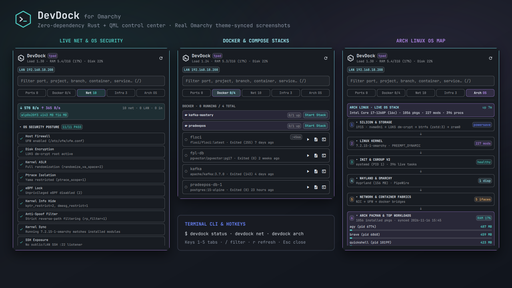

# DevDock for Omarchy



**A self-contained, zero-dependency Rust + QML Dev, DevOps & Arch OS Control Center for the Omarchy bar and terminal.**

Powered by a single ~720 KB native Rust binary compiled strictly against `std` (zero external Cargo crates, zero root privileges, zero external audit dependencies), **DevDock** puts live local dev servers, HTTP health/latency probes, UNIX-socket Docker/Podman with instant inline logs & Compose stacks, live internet traffic & kernel security posture, Kubernetes `PROD` guards, systemd health, and an interactive **Arch Linux OS Architecture Map** one click away in your Omarchy bar.

---

## Features & Tabs

### 1. Ports, Tunnels & Health Probes (`1`)
- Native `/proc/net/tcp`, `/proc/net/tcp6`, and `/proc/<pid>/*` scanner — resolves **project folder**, **Git branch** (reads `.git/HEAD` directly, including worktrees), **framework/stack** (Next.js, Vite, Astro, FastAPI, Django, Spring/Java, Rust, Go, Kafka, LocalStack/Floci, PostgreSQL, Redis, MySQL, MongoDB, Ollama), **RAM**, and **uptime**.
- **1-Click HTTP / TCP Health Probe (`󰓅`)**: Pure-Rust `TcpStream` `HEAD /` probe displaying live status & latency (`200 OK · 1.2ms` / `TCP open · 0.4ms`) directly on the port row.
- Automatic **SSH (`-L`/`-R`/`-D`) & `kubectl port-forward`** tunnel detection.
- **`local` vs `LAN` (`0.0.0.0`) scope badge** with 1-click Copy LAN URL, **Hyprland Jump-to-Terminal** (`focus <pid>`), and UID + socket-verified two-step **Stop → Force Kill**.
- Separates IDE/Gradle/desktop IPC ports into a collapsible **Background, IDE & System** drawer.

### 2. Docker & Podman + Inline Logs (`2`)
- Talks **HTTP/1.1 strictly over the local `/run/docker.sock` or Podman UNIX socket** in Rust — eliminating cold Go CLI startup lag and never silently switching to a remote `DOCKER_HOST` or CLI context on local daemon failure.
- **Docker Compose Stack Grouping**: Detects `com.docker.compose.project` stacks with 1-click **Start Stack** / **Stop Stack** pinned to the exact verified container IDs on the local socket.
- **Zero-lag optimistic Start / Stop / Restart** per container + **1-click Interactive Shell (`exec sh`)** pinned to the local UNIX socket (`-H unix://...` / `--url unix://...`).
- **Instant Inline Log Viewer (~2 ms)** right inside the popup (decodes Docker's 8-byte multiplexed stdout/stderr frame headers, strips ANSI codes, supports **Live ●** auto-tail, and copies logs directly via stdin pipe so log text never appears in process arguments) + detached **Pop out in Terminal** (`setsid foot -H` / `alacritty --hold` / `kitty --hold` / `ghostty`).
- **Crash Watchdog**: Optional desktop notifications (`notify-send`) when a running dev server or container exits unexpectedly.

### 3. Live Internet Traffic & OS Security Radar (`3`)
- **Live Throughput HUD**: Real-time `↓ RX / ↑ TX` rates from `/proc/net/dev` across Wi-Fi, Ethernet, VPN, and Docker bridges.
- **Process-Attributed Connections**: Maps every active `ESTABLISHED` / `SYN` internet & LAN socket to its owning process (`comm`, `pid`, `exe`) with Inbound (`↙`) vs Outbound (`↗`), protocol tags (`HTTPS`, `HTTP`, `SSH`, `DNS`, DBs), **1-click on-demand Reverse DNS (`rDNS`)**, **Jump to Window**, safe UID-verified **Stop Process**, and **critical alerts** if a deleted or `/tmp`/`/dev/shm` binary calls the internet.
- **11 Self-Contained OS Hardening Checks (Zero Root)**: Live systemd firewall status (distinguishing running services from root-verified filtering policies), all-branch mounted-root LUKS dm-crypt verification (`/proc/self/mountinfo` + `/sys/fs/btrfs/*/devices` + `/sys/class/block/*/slaves` + `dm/uuid`), ASLR, Yama ptrace, eBPF lock, `kptr`/`dmesg` isolation, `rp_filter`, Arch kernel-reboot drift, SSH `:22` exposure, `0.0.0.0` local DB/broker guard, and runtime traffic anomalies.

### 4. Infra — Kubernetes & Systemd (`4`)
- Kubeconfig loader using `kubectl config view -o json` when available (zero network calls) with a strict native JSON + YAML multi-file `$KUBECONFIG` fallback that fails closed (`K8s?` target unknown warning) if any file cannot be safely parsed, plus a persistent red **`PROD` context warning**, 1-click context switching, and `AWS_PROFILE` badge.
- Failed system & user systemd unit alerts + installed DevOps daemon health with 1-click `journalctl` logs.

### 5. Interactive Arch OS Architecture Map (`5`) & 16 Color Palettes (`t`)
- Live 6-layer interactive diagram built straight from `/proc`, `/sys`, Hyprland IPC, and `/var/lib/pacman/local`:
  1. **Silicon & Storage**: CPU model/cores/governor, DRM GPU driver + PCI ID, live storage chain (`nvme0n1 → LUKS dm-crypt → btrfs (zstd:3) → zram0`), Btrfs subvolumes, and swap.
  2. **Linux Kernel**: Release, preemption model, loaded modules count, installed kernels, active LSM stack, and taint status.
  3. **Init & Cgroup v2**: PID 1, unified cgroup v2 controllers, and live task count.
  4. **Wayland & Omarchy**: Compositor & shell memory footprint, PipeWire audio, and live connected displays.
  5. **Network & Container Fabrics**: Live NICs, firewall, and Docker bridges with RX/TX counters.
  6. **Arch Pacman & Top Workloads**: Instant local package count, last sync timestamp, and proportional **Top 6 RAM consumer** bars.
- **16 Live Color Palettes (`󰏘` / `t`)**: `Auto` (live Omarchy `colors.toml`), `Crimson`, `Bloodline`, `Cyber`, `Matrix`, `Synthwave`, `Amber`, `Tokyo`, `Catppuccin`, `Rosé Pine`, `Dracula`, `Kanagawa`, `Everforest`, `Nord`, `Gruvbox`, and `Mono` — persisted cleanly via Omarchy's `updateEntryInline`.

---

## Keyboard Shortcuts (Inside Popup)

| Key | Action |
| --- | --- |
| `1` `2` `3` `4` `5` | Switch tabs (Ports / Docker / Net / Infra / Arch OS) |
| `t` | Toggle the 16-theme Color Palette picker |
| `/` | Focus instant filter search |
| `r` | Refresh snapshot immediately |
| `Esc` | Close palette picker, inline logs, clear search, or close popup |
| `Tab` | Cycle Omarchy bar panels |

---

## Terminal CLI

The compiled Rust binary (`devdock`) also works standalone in any terminal:

```bash
devdock status                              # Full DevOps, Security & Arch overview
devdock status --all                        # Include background/IDE/system ports
devdock net                                 # Live internet connections & OS hardening
devdock arch                                # 6-layer Arch Linux architecture summary
devdock probe 3000                          # HTTP HEAD / TCP latency probe
devdock container-tail <id> 120             # Direct UNIX-socket container logs (~2 ms)
devdock stack start <compose-project>       # Start an entire Compose stack
devdock rdns 1.1.1.1                        # On-demand reverse DNS lookup
```

---

## Installation

### Via Omarchy Plugin Manager (Recommended)

Install through the Omarchy plugin catalog (`io.github.pradeepjung45.devdock`), then build the zero-dependency Rust backend locally from the installed plugin's audited source (requires `cargo`):

```bash
cd ~/.config/omarchy/plugins/io.github.pradeepjung45.devdock
bash ./install.sh
```

`install.sh` compiles with `cargo build --release --locked`, installs the plugin-private binary to `bin/devdock`, and writes `bin/devdock.sha256`. On startup, `Service.qml` exclusively executes `bin/devdock` after verifying both `bin/devdock.sha256` and the compile-time source digest pinned in `Model.js` (`EXPECTED_SOURCE_SHA256`). No prebuilt binaries are downloaded.

### Toggle via Keybinding or CLI

```bash
omarchy-shell io.github.pradeepjung45.devdock toggle
```

## Removal

```bash
omarchy plugin disable io.github.pradeepjung45.devdock
omarchy plugin remove io.github.pradeepjung45.devdock
rm -f ~/.local/bin/devdock
```

## External Dependencies & Permissions

- **Build dependency**: Rust toolchain (`cargo` / `rustc`, edition 2024) — zero external Cargo crates.
- **Runtime (optional tools, gracefully skipped if absent)**: `wl-copy` (clipboard), `xdg-open` (browser), `foot`/`ghostty`/`alacritty`/`kitty` (pop-out terminal), `kubectl` (context switching), `notify-send` (crash watchdog).
- **Security**: 100% local, zero telemetry, zero root required, zero shell interpolation (`sh -c`), `Text.PlainText` everywhere, and namespaced `ShellIpc` (`io.github.pradeepjung45.devdock`).

## Testing

```bash
cargo test --locked
node --test "test/*.test.mjs"
omarchy plugin validate ~/.config/omarchy/plugins/io.github.pradeepjung45.devdock
```

## License

MIT — see [LICENSE](LICENSE).
